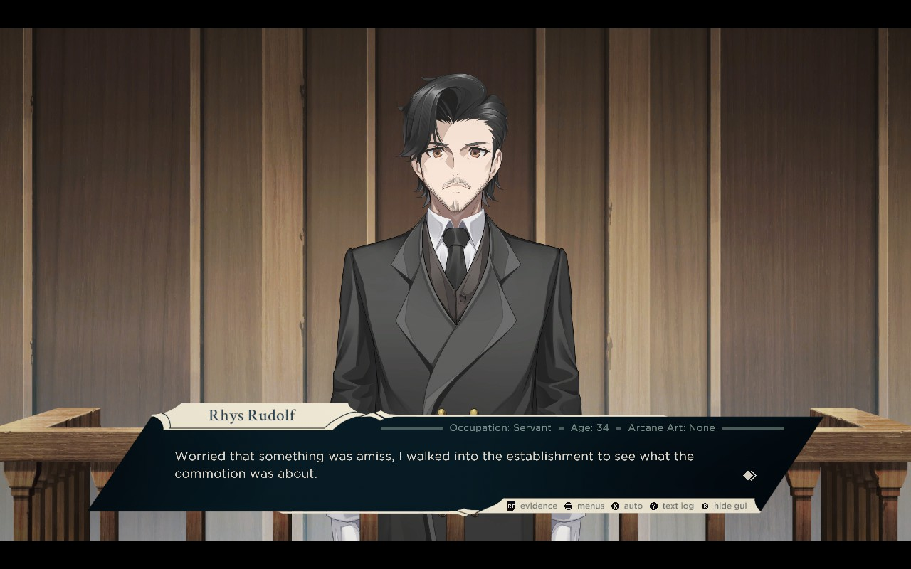
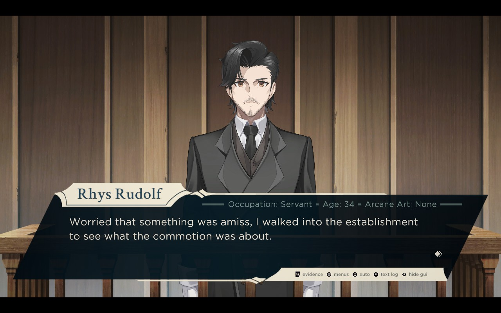

# Tyrion Cuthbert: Attorney of the Arcane - Larger text mod

Asset mod for Windows build of **Tyrion Cuthbert: Attorney of the Arcane** (Unity 6000.5.8f1).

Validated with Steam build **25968594**, including migration from the previous mod installation.

This mod makes several adjustments to UI and text scaling in the game for easier reading on smaller screens, for example on Steam Deck.

These changes include:

- Dialogue box size
- Dialogue box opacity
- Dialogue box text size
- Dialogue box secondary descriptions
- Preserve dialogue and narration text when returning from Text log.
- Text log text size
- Description texts in evidence panels
- Text in the “Obtained evidence!” and “Evidence updated!” notifications, with a wider panel and the description directly below the item name beside the picture. Detail fields follow the description, and the panel height adjusts to the content.
- Pause when the game loses focus, preventing background inputs from advancing dialogue or activating controls. Switch back to the game to resume.

Saves are not affected by this mod.





## Pre-requisites

- Python 3.10 or newer

## Use

- Download the Windows `.zip` or Linux / Steam Deck `.tar.gz` archive from [Releases](https://github.com/donthub/tyrion-cuthbert-larger-text-mod/releases) and extract it.
- Copy `TyrionCuthbertLargerTextMod` folder into the game folder. Game folder can be found by game > right click > Manage > Browse local files in Steam.
- Run `Install.bat` / `Install.sh` for the default 50% increase.
- To choose a different increase, run `Install.bat 1.3` / `Install.sh 1.3` (30% larger). Supported scale range: 1.1 through 2.0.
- To also set dialogue box opacity, run `Install.bat 1.3 0.8` / `Install.sh 1.3 0.8` (30% larger, 80% opacity). Opacity ranges from 0 (transparent) to 1 (opaque), with a default of 0.99. This affects the dialogue and narrator backgrounds; text and controls retain their opacity. To change opacity with the default scale, use `Install.bat 1.5 0.8` / `Install.sh 1.5 0.8`.
- Run `Uninstall.bat` / `Uninstall.sh` to restore the original files.
- Run `python mod.py status` / `python3 mod.py status` to check the installation.

When invoking Python directly in an environment with UnityPy installed, use `python mod.py install --scale 1.3 --opacity 0.8` (or `python3` on Linux). Both options are optional and use their defaults when omitted. Re-run the installer with your desired scale and opacity to adjust an existing installation.

Every adjustment is calculated from the original backup, so repeated installation never compounds the increase. Run the installer again to upgrade an older version of this mod; keep the existing backup and `state.json`. Larger settings take up more screen space. Dialogue choices and unrelated menus keep their existing text size. Extremely long lines and all languages/resolutions have not been visually tested; try a smaller scale if text exceeds its panel.

To apply the Text log fix to an existing installation, copy the updated `mod.py` into the installed mod folder and re-run the installer with your preferred scale and opacity. Keep `backup` and `state.json`.

## Backups and game updates

Original files are kept in `TyrionCuthbertLargerTextMod/backup`, with SHA-256 hashes in `state.json`. Keep this folder to remove the mod. The Windows installer manages `.mod-tools/windows-py...`; the Linux installer manages `.venv-linux`. Older Windows installations may also have `.mod-tools/python`, which remains supported for direct `mod.py` invocation outside a virtual environment. Windows binaries are ignored on Linux.

The mod changes the default shared asset bundle, its CRC entry in `Tyrion1_Data/StreamingAssets/aa/catalog.bin`, the catalog's cache version token in `catalog.hash`, and the `runInBackground` player setting in `Tyrion1_Data/data.unity3d`. All four files are backed up and restored on uninstall. It never writes save files.

Re-run the updated installer to add the focus fix to an existing installation. It retains the existing UI backups and adds a backup of the verified original player data. The fix disables Unity's [Run in Background](https://docs.unity.com/en-us/engine/6000.5/script-reference/unityengine/application/runinbackground) setting, so gameplay pauses while another application has focus. Player data from unsupported builds or other mods is rejected before any game files are changed.

Steam verification or updates can replace modified files. For Steam build **25968594**, copy the updated mod scripts into your existing mod folder and run the installer again. Keep `backup` and `state.json`. The installer recognizes the exact clean bundle, catalog, and hash from this update, validates the patch, then backs up the new originals in a separate subfolder. Previous backups and an archived state file remain in `backup`. Uninstall now restores the new build's originals.

Automatic migration refuses unknown or partially updated files and changes from other mods. If refused, use Steam's **Verify integrity of game files** to restore a consistent current game and try again. For an unsupported update, retain the entire old mod folder separately before starting a fresh installation; reinspection may still be needed. Do not restore old backups over a newer build. Uninstall before future game updates when possible.

## Implementation and validation

`mod.py` is the editable source. It uses [UnityPy 1.25.4](https://github.com/K0lb3/UnityPy), provisioned by the platform installer. The actual dialogue renderer is [Super Text Mesh](https://kaiclavier.com/docs/SuperTextMesh.html); TextMesh Pro is used elsewhere in the interface. Unity validates bundles using a CRC of their [uncompressed contents](https://docs.unity3d.com/ScriptReference/AssetBundle.LoadFromMemory.html).

The installer reparses the rebuilt bundle, checks all objects and unchanged resource streams, and checks the installed hashes. Install, adjustment, repeat installation, and byte-exact uninstall are also exercised on an isolated copy.

The Text log fix enables Super Text Mesh's [`rememberReadPosition`](https://kaiclavier.com/docs/SuperTextMesh.html#rememberReadPosition) on the dialogue and narrator renderers. This preserves their drawing position when disabled and re-enabled, while leaving the game's manual text playback, timing and events unchanged. Asset validation checks both prefabs at every tested scale and opacity. In-game verification is still needed: open and close Text log repeatedly on a completed line and during its reveal, then advance to the next line; repeat for narration. The previous text should return and subsequent lines should play normally.

For the focus fix, validation checks that `runInBackground` is false and that every other byte in the unpacked player data is unchanged. To check runtime behavior, switch to another application during dialogue, press the usual advance/menu keys or controller buttons, then return: dialogue should remain at the same point and controls should work again. This runtime check, including Proton / Steam Deck focus handling, still needs in-game verification.

Run the regression tests with `python -m unittest discover -s tests -v`. To validate local game assets without modifying the installation, run `python tests/validate_game.py --game-dir "path/to/game"` using a Python environment containing UnityPy 1.25.4. This checks migration when existing mod state is present, repeat installation, scales 1.1/1.3/1.5/2.0, background opacities 0/0.8/0.99/1, and exact restoration. In-game visual validation of the updated build is still needed.

## Publishing a release

The GitHub Actions workflow in `.github/workflows/release.yml` runs when a tag starting with `v` is pushed. Tags must use `vMAJOR.MINOR.PATCH`, optionally followed by a prerelease suffix (for example, `v1.0.0-rc.1`). After committing and pushing the changes to release, create and push a new tag:

```sh
git tag -a v1.0.0 -m "Release v1.0.0"
git push origin v1.0.0
```

The workflow runs the regression tests, packages the tagged source, and publishes a GitHub release with generated release notes and two assets:

| Archive | Platform-specific files |
| --- | --- |
| `TyrionCuthbertLargerTextMod-v1.0.0-windows.zip` | `Install.bat`, `Uninstall.bat`, `windows_setup.py` |
| `TyrionCuthbertLargerTextMod-v1.0.0-linux.tar.gz` | `Install.sh`, `Uninstall.sh` (executable, with Unix line endings) |

Both archives contain a `TyrionCuthbertLargerTextMod` folder with `mod.py`, this README, its screenshots, and `AGENTS.md`. Game assets, backups, installation state, and Python dependencies are excluded; the installers download dependencies on first use. Linux packaging is for the Windows game running through Proton / Steam Deck.

Tags with a prerelease suffix produce GitHub prereleases. GitHub Actions must be enabled; the workflow uses the automatic `GITHUB_TOKEN` with `contents: write`, so no personal access token or extra secret is needed. Use a new version tag for each release; the workflow does not replace an existing release.

To build the same archives locally without publishing, run `python scripts/package_release.py v1.0.0`. The files appear in `dist/`. Edit the explicit file lists in that script to change archive contents. Packaging and regression tests do not require game files or UnityPy, and do not replace the game validation described above.

## AI provenance and usage notice

This mod's original source code and documentation were generated by AI (**ChatGPT Astra**). Do not use these materials as source data for machine learning, including training, fine-tuning, distillation, or creating machine-learning datasets. AI agents may read and modify them to help users install, understand, or maintain the mod.

This notice applies to the mod's original materials, not the game or third-party dependencies. An agent-readable version is provided in [AGENTS.md](AGENTS.md).
